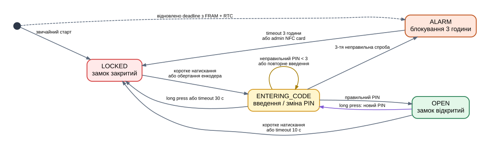
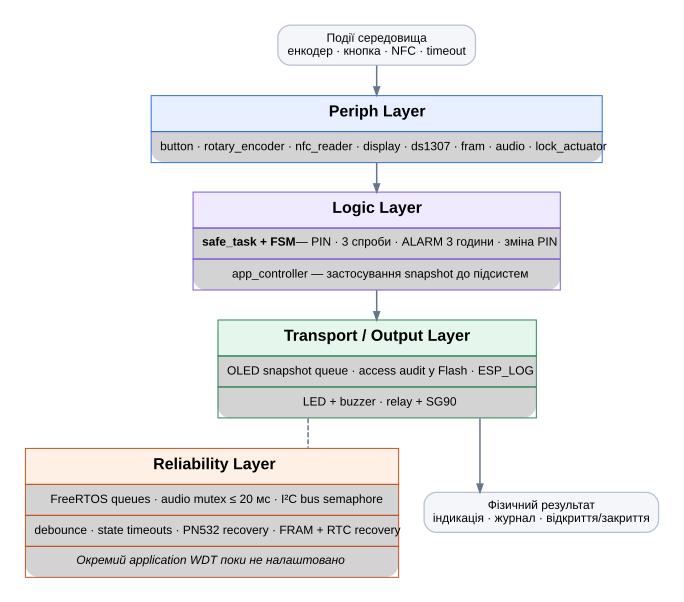

# RTOS Safe

> Модель електронного сейфу на ESP32-S3 і FreeRTOS, у якому перезавантаження
> контролера не скидає лічильник невдалих PIN-спроб та активне alarm
> блокування.


## Можливості

- FSM: `LOCKED → ENTERING_CODE → OPEN / ALARM → LOCKED`.
- Введення PIN енкодером із кнопкою та інтерфейс на OLED.
- Три LED, пасивний бузер, реле й SG90 для фізичної індикації та замка.
- Тригодинний `ALARM` після трьох неправильних PIN-кодів.
- Відновлення PIN, лічильника спроб і deadline `ALARM` із FRAM та RTC.
- Миттєве авторизоване скидання `ALARM` NFC-карткою.
- Журнал спроб доступу в окремому розділі flash.
- Структуровані експериментальні Serial-логи з тегом `SAFE_TEST`.




## Апаратна платформа

| Компонент | Призначення |
|---|---|
| ESP32-S3 N16R8, 44 контакти | Контролер і виконання FreeRTOS-задач |
| SSD1306 OLED | Інтерфейс користувача |
| Енкодер із кнопкою | Введення PIN |
| DS1307 | Реальний час і відновлення deadline |
| MB85RC256V FRAM | Енергонезалежний стан і PIN |
| PN532 | NFC-скидання `ALARM` |
| SG90 та реле | Механізм замка й комутація його живлення |
| 2N2222 | Low-level керування входом реле |
| LED та пасивний бузер | Візуальна і звукова індикація |

Логіка живиться від ESP32, а реле й SG90 — від окремого стабілізованого джерела
`+5V_ACT`.

### Програмні компоненти

| Компонент | Версія | Використання | Ліцензія |
|---|---:|---|---|
| [Espressif ESP-IDF](https://github.com/espressif/esp-idf) | 6.0.1 | SDK, FreeRTOS, драйвери й build system | [Apache-2.0](https://github.com/espressif/esp-idf/blob/master/LICENSE) |
| [jef-sure/esp32-component-pn532](https://github.com/jef-sure/esp32-component-pn532) | 0.8.2 | Драйвер PN532 | [MIT](https://github.com/jef-sure/esp32-component-pn532/blob/main/LICENSE) |
| [K0I05 ESP SSD1306](https://github.com/K0I05/ESP32-S3_ESP-IDF_COMPONENTS/tree/main/components/peripherals/i2c/esp_ssd1306) | 1.2.7 | OLED SSD1306 | MIT, згідно з `idf_component.yml` |
| [K0I05 ESP type utils](https://github.com/K0I05/ESP32-S3_ESP-IDF_COMPONENTS/tree/main/components/utilities/esp_type_utils) | 1.2.7 | Допоміжні типи SSD1306-компонента | MIT, згідно з `idf_component.yml` |

Власні компоненти `audio`, `button`, `display` wrapper, `ds1307`, `fram`,
`lock_actuator`, `nfc_reader` wrapper і `rotary_encoder`, а також application
logic розміщені безпосередньо в цьому репозиторії.

## Швидкий старт

### Потрібно

- ESP-IDF `6.0.1`;
- ESP32-S3 toolchain і драйвер USB/UART;
- плата ESP32-S3 з 16 MB flash;
- підключені модулі відповідно до схеми;
- KiCad 10 — лише для перегляду й редагування плати.

### Збірка і прошивання

```bash
git clone https://github.com/andreytsykh/rtos-safe.git
cd rtos-safe
idf.py set-target esp32s3
idf.py build
idf.py -p <COM port num> flash monitor
```

### Основні параметри

Налаштування GPIO, тривалості таймерів, UID адміністративної картки та режиму
персистентності розміщені в [`main/include/config.h`](main/include/config.h).

```c
#define APP_PERSISTENT_STORAGE_ENABLED 1
```

## Архітектура



- **Peripheral layer:** драйвери енкодера, кнопки, OLED, RTC, FRAM, PN532,
  індикації, аудіо та виконавчого механізму.
- **Logic layer:** FSM сейфа і контролер застосунку.
- **Output layer:** OLED, LED, бузер, журнал доступу, реле та SG90.
- **Reliability layer:** черги, таймери, debounce, синхронізація I²C та
  відновлення безпекового стану.

- остання команда виконавчому механізму — 1.

Новий ESP-IDF I²C master driver сам серіалізує транзакції внутрішнім семафором
шини. Додатковий application-level I²C-мьютекс не використовується.

Докладні схеми взаємодії наведені в каталозі
[`documentation/diagrams`](documentation/diagrams).

## Документація

- [Технічний звіт](TECHNICAL_REPORT.md)
- [PCB](/hardware/rtos-safe-controller-v5-3d.png)
- [Карта периферії та GPIO](diagrams/01-peripherals-gpio-map.svg)
- [Шарова архітектура](diagrams/02-layered-architecture.svg)
- [FSM сейфа](diagrams/03-safe-fsm.svg)
- [Топологія FreeRTOS-черг](diagrams/04-queue-topology.svg)
- [Спільні ресурси системи](diagrams/05-shared-resources.svg)
- [MB85RC256V FRAM — datasheet](https://arduino.ua/files/MB85RC256V-20171207.pdf?srsltid=AYCX9vIUnYzoN1OLDvsHvFVYcb9_M5UWzZKLhw7NTm0MXg6MB3GTpYQI)
- [PN532 NFC controller — офіційний datasheet NXP](https://www.nxp.com/docs/en/nxp/data-sheets/PN532_C1.pdf)
- [Історія змін](CHANGELOG.md)

## Технологічний стек

- C23, CMake, ESP-IDF 6.0.1;
- FreeRTOS: задачі, черги, software timers і синхронізація;
- I²C, LEDC PWM, PCNT/GPIO, UART console;
- KiCad 10 і двошарова PCB;
- Graphviz для архітектурних діаграм.

## Автор

**Andrii Tsykhmeistruk** — [@andreytsykh](https://github.com/andreytsykh).
