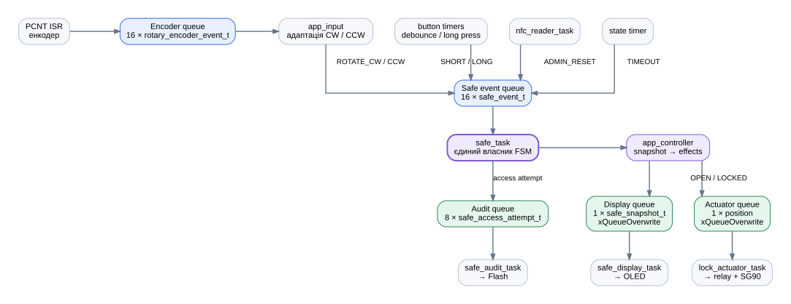

# Технічний звіт: RTOS Safe

**Версія:** 1.1.0  
**Платформа:** ESP32-S3 N16R8, ESP-IDF 6.0.1, FreeRTOS  
**Автор:** Andrii Tsykhmeistruk

## 1. Анотація

RTOS Safe — навчальна вбудована система електронного сейфа на ESP32-S3. Вона
поєднує FSM, паралельні задачі FreeRTOS, черги подій, OLED-інтерфейс, енкодер,
NFC-авторизацію, звукову та світлову індикацію і керування фізичним замком.

Основна досліджувана проблема — обхід тривожного блокування перезапуском. У
базовій реалізації лічильник неправильних PIN-кодів та стан `ALARM` існували
тільки в RAM. Після вимкнення живлення ESP32 запускалася з нульовим лічильником,
тому користувач знову отримував три спроби. Для усунення цієї вразливості стан,
PIN і абсолютний deadline блокування перенесено в зовнішню FRAM MB85RC256V, а
поточний час отримується з DS1307. Після reboot система відновлює кількість
спроб, перевіряє deadline і запускає `ALARM` на весь залишковий час.

Проєкт містить прошивку, KiCad rev 5, розведену двошарову PCB, архітектурні
діаграми й журнали апаратних випробувань. Поточні результати підтверджують
збереження невдалих спроб після reboot; повна статистична серія з десяти
повторів ще виконується.

## 2. Постановка задачі

Необхідно розробити навчальний електронний сейф, який:

1. приймає PIN через енкодер і кнопку;
2. відкриває замок після правильного PIN;
3. після трьох неправильних PIN переходить у `ALARM` на три години;
4. не дозволяє обійти ліміт спроб перезапуском контролера;
5. відновлює залишковий час `ALARM` після втрати основного живлення;
6. дозволяє адміністратору миттєво скинути тривогу NFC-карткою;
7. журналює спроби доступу;
8. зберігає керованість периферії за умов паралельної роботи задач.

### 2.1. Загроза

Для RAM-only реалізації послідовність обходу виглядає так:

```text
3 неправильні PIN → ALARM → reboot → attempts = 0 → ще 3 спроби
```

Отже, локальний зловмисник із доступом до живлення може отримувати необмежену
кількість серій введення PIN.

### 2.2. Критерії приймання

- після reboot відновлюється точна кількість використаних спроб;
- активний `ALARM` після reboot залишається активним;
- залишковий час визначається як `deadline − RTC_NOW`;
- завершений deadline не запускає нове тривале блокування;
- авторизована NFC-картка скидає `ALARM` і лічильник;
- втрата або пошкодження зовнішнього компонента не повинні відкрити замок;
- критичні черги не повинні втрачати події під час нормальної експлуатації.

## 3. Огляд наявних рішень

### 3.1. Зберігання тільки в RAM

RAM має нульову затримку доступу й не потребує додаткового обладнання, але
повністю втрачає стан після reset або зникнення живлення. Для безпекового
лічильника це створює прямий шлях обходу.

### 3.2. Внутрішня flash / NVS

ESP-IDF NVS може зберігати стан без додаткової мікросхеми. Водночас flash має
обмежену кількість циклів стирання, сторінкову організацію і потребує wear
levelling для частих оновлень.

### 3.3. FRAM і RTC

FRAM підтримує швидкі байтові записи без попереднього стирання і має значно
вищу витривалість за типову flash. RTC продовжує відлік від резервної батареї,
коли ESP32 знеструмлена. Комбінація FRAM + RTC дозволяє зберегти абсолютний
deadline і не залежати від того, скільки часу контролер був вимкнений.

Обране рішення не є криптографічним захистом FRAM від фізичного втручання. Воно
усуває конкретну логічну вразливість перезапуску, що відповідає навчальній меті
проєкту.

## 4. Опис реалізованої системи

### 4.1. Апаратна частина

Центральний контролер — ESP32-S3 N16R8. Логічна периферія працює через спільну
I²C-шину 100 кГц:

| Пристрій | Адреса | Функція |
|---|---:|---|
| SSD1306 | `0x3C` / `0x3D` | OLED |
| DS1307 | `0x68` | Реальний час |
| MB85RC256V | `0x50` | Енергонезалежний стан |
| PN532 | `0x24` | NFC |

SG90 отримує PWM з GPIO4 через резистор R6 `1 кОм`. Його окреме живлення
комутується контактом `NO` реле. GPIO7 керує low-trigger входом реле через
2N2222; резистор R5 `10 кОм` утримує транзистор вимкненим під час старту ESP32.

Силова частина (замок) живиться від окремих `5 В`, логіка — від ESP32. Силова і логічна частина мають спільну землю. 
На вході `+5V_ACT` та після контакту реле встановлено фільтрувальні
конденсатори.

Актуальні вихідні файли плати:

- [`hardware/rtos-safe-controller-v5.kicad_sch`](hardware/rtos-safe-controller-v5.kicad_sch);
- [`hardware/rtos-safe-controller-v5.kicad_pcb`](hardware/rtos-safe-controller-v5.kicad_pcb);
- [`hardware/rtos-safe-controller-schematic-v5-final.pdf`](hardware/rtos-safe-controller-schematic-v5-final.pdf).

### 4.2. FSM

```text
LOCKED → ENTERING_CODE → OPEN
                     └→ ALARM → LOCKED
```

- `LOCKED`: замок закритий, очікується початок введення.
- `ENTERING_CODE`: формується PIN і працює таймер введення.
- `OPEN`: SG90 переміщує механізм, після таймера сейф закривається.
- `ALARM`: замок залишається закритим, доступ блокується до deadline або
  авторизованого NFC-скидання.

Під час старту FSM може одразу перейти в `ALARM`, якщо FRAM містить активний
стан, а RTC показує, що deadline ще не настав.

### 4.3. FreeRTOS-архітектура

Система розділена на логіку сейфа, введення, дисплей, аудит, аудіо й керування
виконавчим механізмом. Взаємодія відбувається через черги та snapshots, тому
повільне фізичне переміщення SG90 не блокує обробку FSM.



Використовуються:

- черга подій FSM;
- черга енкодера;
- черга журналу доступу;
- одновимірні overwrite-черги для останнього стану дисплея й позиції замка;
- software timers для введення, відкритого стану та `ALARM`;
- внутрішній семафор нового ESP-IDF I²C master driver;
- `audio_mutex` для стану аудіоплеєра.

### 4.4. Персистентний стан

FRAM-запис містить magic, версію формату, кількість використаних спроб,
прапорець `ALARM`, абсолютний deadline, PIN і прапорець його валідності.

Алгоритм старту:

1. Ініціалізувати I²C, RTC і FRAM.
2. Прочитати та перевірити FRAM-запис.
3. Відновити `attempts_used` і PIN.
4. Якщо `ALARM` активний, прочитати RTC.
5. Якщо `RTC_NOW < deadline`, запустити `ALARM` на різницю часу.
6. Якщо deadline минув, очистити збережене блокування.

Якщо deadline не вдалося прочитати, реалізація вибирає fail-safe поведінку —
повний інтервал `ALARM`, а не відкриття замка.

### 4.5. Діагностичні логи

Для експериментів використовується тег `SAFE_TEST`:

```text
RESTORED_ATTEMPTS=<0..3>
RESTORED_STATE=<LOCKED|ALARM>
RTC_NOW=<HH:MM:SS>
ALARM_DEADLINE=<HH:MM:SS|NONE>
REMAINING_SEC=<seconds>
```

Однаковий формат дозволяє порівнювати RAM-only та FRAM-конфігурації.

## 5. Результати тестування

Наявний RAM-only журнал містить reboot зі значеннями:

```text
RESTORED_ATTEMPTS=0
RESTORED_STATE=LOCKED
```

Після двох неправильних PIN це означає повернення до нульового лічильника й
дві втрачені спроби. Окремий FRAM-журнал містить:

```text
RESTORED_ATTEMPTS=2
RESTORED_STATE=LOCKED
RTC_NOW=16:45:16
```

Це підтверджує основну ідею: лічильник використаних спроб переживає reboot.

| Метрика | RAM only | FRAM + RTC | Статус |
|---|---:|---:|---|
| Додаткові спроби після reboot при `attempts=3` | 3 | 0 | Архітектурно реалізовано; серія вимірювань триває |
| Відновлення часткового лічильника | Ні | Так (`2` відновлено) | Підтверджено журналом |
| Відновлення активного `ALARM` | Ні | Так | Потрібна завершена серія логів |
| Похибка залишкового часу | Не застосовується | Ще вимірюється | Не завершено |


### 5.1. Відомі обмеження

- Проєкт використовує системні налаштування watchdog ESP-IDF і не встановлює
  окремий application task watchdog.

## 6. Висновки

Проєкт демонструє, що енергонезалежне збереження є частиною безпекової логіки,
а не лише функцією зручності. Перенесення лічильника й стану в FRAM закриває
обхід через reset, а абсолютний deadline у поєднанні з RTC дає змогу врахувати
час, протягом якого ESP32 була вимкнена.

Поточні апаратні журнали підтверджують відновлення часткового лічильника після
reboot. Для остаточного кількісного висновку потрібно завершити по десять
повторів RAM-only і FRAM + RTC, зафіксувати відновлення активного `ALARM` та
розрахувати максимальну похибку залишкового часу.

Подальші кроки: CRC і подвійний FRAM-запис, встановлення датчика для фізичної індикації закриття замку

## 7. Credits

### Програмні компоненти

| Компонент | Версія | Використання | Ліцензія |
|---|---:|---|---|
| [Espressif ESP-IDF](https://github.com/espressif/esp-idf) | 6.0.1 | SDK, FreeRTOS, драйвери й build system | [Apache-2.0](https://github.com/espressif/esp-idf/blob/master/LICENSE) |
| [jef-sure/esp32-component-pn532](https://github.com/jef-sure/esp32-component-pn532) | 0.8.2 | Драйвер PN532 | [MIT](https://github.com/jef-sure/esp32-component-pn532/blob/main/LICENSE) |
| [K0I05 ESP SSD1306](https://github.com/K0I05/ESP32-S3_ESP-IDF_COMPONENTS/tree/main/components/peripherals/i2c/esp_ssd1306) | 1.2.7 | OLED SSD1306 | MIT, згідно з `idf_component.yml` |
| [K0I05 ESP type utils](https://github.com/K0I05/ESP32-S3_ESP-IDF_COMPONENTS/tree/main/components/utilities/esp_type_utils) | 1.2.7 | Допоміжні типи SSD1306-компонента | MIT, згідно з `idf_component.yml` |

Власні компоненти `audio`, `button`, `display` wrapper, `ds1307`, `fram`,
`lock_actuator`, `nfc_reader` wrapper і `rotary_encoder`, а також application
logic розміщені безпосередньо в цьому репозиторії.

### Datasheet ключових компонентів

- [Fujitsu MB85RC256V — 256 Kbit I²C FRAM](https://arduino.ua/files/MB85RC256V-20171207.pdf?srsltid=AYCX9vIUnYzoN1OLDvsHvFVYcb9_M5UWzZKLhw7NTm0MXg6MB3GTpYQI)
- [NXP PN532/C1 — NFC controller](https://www.nxp.com/docs/en/nxp/data-sheets/PN532_C1.pdf)


### Ліцензія самого проєкту

На момент підготовки звіту кореневий файл `LICENSE` відсутній. Це означає, що
ліцензії сторонніх залежностей не надають автоматичного дозволу на повторне
використання власного коду RTOS Safe. Перед публічним розповсюдженням потрібно
окремо обрати й додати ліцензію проєкту.
